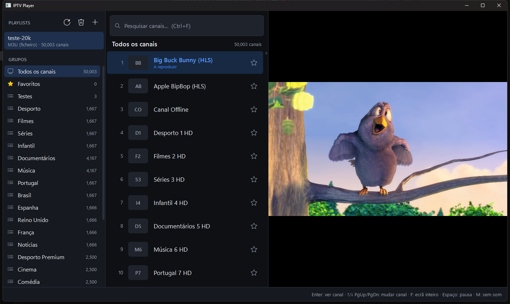
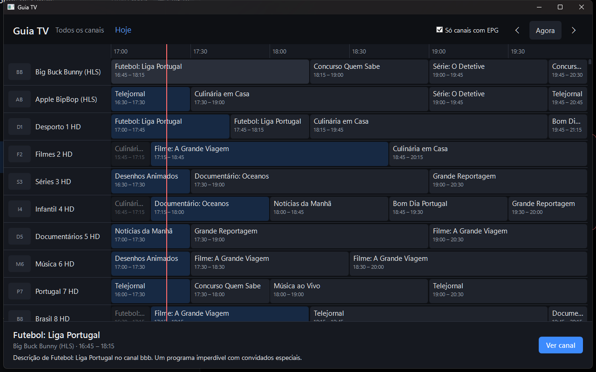
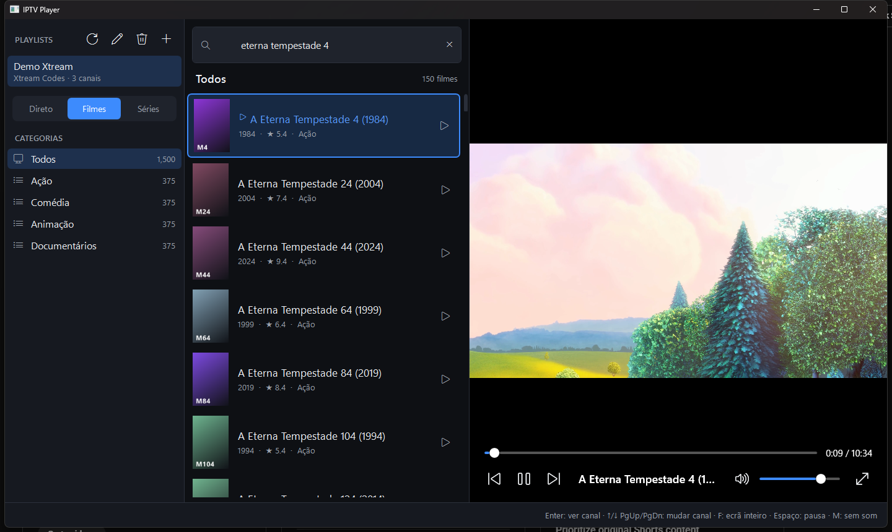
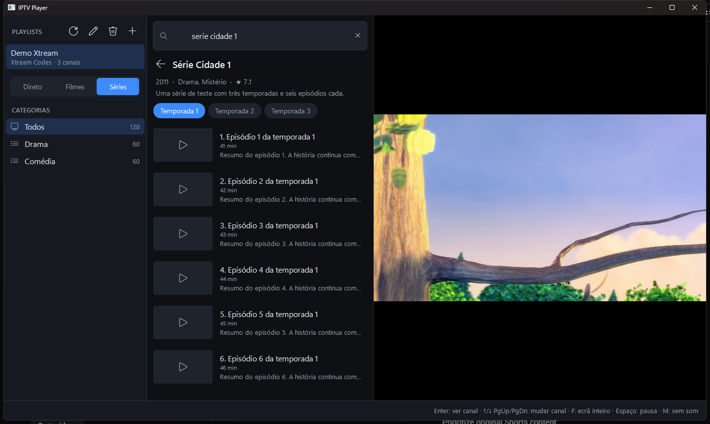
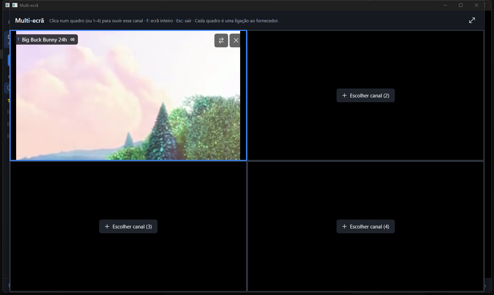

<p align="center"></p>

# PepinoTv

[](https://github.com/vgvcosta/IPTVPlayer/actions/workflows/build.yml)
[](LICENSE)


Leitor de IPTV para Windows (estilo Smart IPTV / TiviMate) para as **tuas próprias** listas de canais:
M3U/M3U8 e Xtream Codes, com EPG e Guia TV, filmes e séries, catch-up, gravações, multi-ecrã e
controlo parental. Interface escura pensada para ver de longe, em português.

.NET 8 · WPF · MVVM (CommunityToolkit.Mvvm) · LibVLCSharp · SQLite.



| Guia TV | Filmes | Séries | Multi-ecrã |
|---|---|---|---|
|  |  |  |  |

## Transferir

Nas [Releases](https://github.com/vgvcosta/IPTVPlayer/releases) há duas opções (ambas já incluem o .NET e o VLC):

- **Instalador** `PepinoTv-x.y.z-win-x64.msi`: instala em `Program Files`, cria atalhos no Menu Iniciar
  e no ambiente de trabalho, e desinstala-se em *Definições → Aplicações*. Instalar uma versão nova
  atualiza a anterior. As playlists e definições (`%AppData%\IPTVPlayer`) são sempre mantidas.
- **Portátil** `PepinoTv-x.y.z-win-x64.zip`: extrai e abre `IPTVPlayer.exe`, sem instalar nada.

O instalador não está assinado digitalmente, por isso o Windows pode mostrar "O Windows protegeu o
computador". Carrega em **Mais informações → Executar mesmo assim**.

> **Aviso:** esta aplicação é só um leitor e **não inclui nem fornece canais ou conteúdos**. Usa-a
> apenas com listas e serviços a que tenhas acesso legítimo.

## Funcionalidades

- **Playlists M3U/M3U8** por URL ou ficheiro local: `#EXTINF` com `tvg-id`, `tvg-name`, `tvg-logo`,
  `group-title`, mais `#EXTGRP`, `#EXTVLCOPT` (user-agent / referrer) e `url-tvg` (EPG).
- **Xtream Codes** (servidor, utilizador, password) via `player_api.php`: canais em direto,
  **filmes** e **séries** (temporadas e episódios), cada um com as suas categorias.
- **Várias playlists**: adicionar, **editar** (nome, endereço/credenciais, URL de EPG manual), atualizar e remover.
- **EPG (XMLTV)**: do `url-tvg` da playlist, do `xmltv.php` do servidor Xtream ou de um URL/ficheiro
  manual (`.xml` ou `.xml.gz`). Associação aos canais pelo `tvg-id` ou, se não houver, pelo nome
  ("PT: RTP 1 HD" ↔ "RTP 1"). A lista mostra o programa atual com uma barra de progresso, e a tooltip
  mostra "agora / a seguir". O **Guia TV** é uma grelha de programação. O EPG atualiza-se sozinho
  a cada 12 h.
- **Reconexão automática**: se um stream que estava a tocar cair (erro, fim inesperado ou imagem
  parada mais de 15 s), a app religa até 5 vezes com espera crescente. Nos filmes retoma na mesma
  posição.
- **Filmes e episódios**: barra de tempo, avançar/recuar, "Terminou → Ver de novo" e
  episódio seguinte/anterior com PgDn/PgUp.
- **Continuar a ver**: a posição de filmes e episódios é guardada a cada 5 s. Ao voltar, retoma onde
  ficou ("A retomar em 12:34 · Começar do início"). As capas mostram o progresso e os vistos têm ✓.
  Há uma categoria **Continuar a ver** em Filmes e Séries, e a página de uma série abre na temporada
  que estavas a ver.
- **Favoritos de filmes e séries** (☆ na lista), com a sua própria categoria.
- **Catch-up / arquivo**: nos canais com arquivo (⟲) podes ver programas que já passaram a partir do
  Guia TV, ou o programa atual **desde o início** (botão no player ou tecla **R**), e depois voltar ao
  direto. Suporta Xtream (`tv_archive`, na hora do servidor) e M3U (`catchup` = `default`, `append`,
  `shift`, `flussonic` ou `xc`, mais `catchup-days`/`tvg-rec` e `catchup-source`, também no `#EXTM3U`).
- **Controlo parental**: PIN de 4 a 8 algarismos e grupos/categorias bloqueados por playlist. O
  conteúdo bloqueado fica escondido da lista, da pesquisa, dos favoritos e do guia até se introduzir
  o PIN. Abrir um grupo bloqueado ou as Definições pede o PIN, e "Bloquear" volta a esconder tudo.
  Há um botão que sugere os grupos para adultos ("Adultos", "XXX", "+18"…).
- **Áudio e legendas**: escolher a faixa de áudio e as legendas (botão CC no player, ou teclas **A** / **S**),
  abrir legendas de um ficheiro (.srt, .ass, .vtt…) e definir idiomas preferidos, aplicados automaticamente.
- **Gravações**: **●** no player (ou **Ctrl+R**) grava o canal até ao fim do programa (2 h sem EPG).
  No Guia TV, **Gravar** agenda programas futuros (a app tem de estar aberta). A janela **Gravações**
  (na barra de baixo) permite ver, parar, apagar e abrir a pasta. Grava em `.ts` sem recodificar e,
  se a ligação cair, continua numa "parte 2". A pasta escolhe-se nas Definições (por omissão
  `Vídeos\PepinoTv`).
- **Multi-ecrã** (botão ⊞ ou tecla **V**): até 4 canais ao mesmo tempo. Clica num quadro (ou 1–4) para
  ouvir esse canal, e F põe a vista em ecrã inteiro.
- **Comando / gamepad** (Xbox/XInput) e teclas multimédia: cruzeta para navegar · A = OK · B = voltar ·
  X = pausa · Y = ecrã inteiro · LB/RB = canal anterior/seguinte · LT/RT = recuar/avançar ·
  View = Guia TV · Menu = pesquisar. Só atua quando a app está em primeiro plano.
- **Definições** (⚙ no canto inferior esquerdo): PIN, grupos bloqueados, buffer de rede, aceleração
  por hardware, idiomas preferidos, pasta das gravações, comando e limpeza da cache de imagens.
- **Ligações ao fornecedor**: cada gravação e cada quadro do multi-ecrã é uma ligação extra. Muitos
  fornecedores só permitem 1 ou 2; se exceder, o quadro ou a gravação mostra "sem sinal".
- **Três colunas**: playlists e grupos · canais com logótipo · player.
- **Pesquisa em tempo real**, sem distinguir maiúsculas nem acentos ("noticias" encontra "Notícias").
- **Favoritos** por playlist, que se mantêm quando a playlist é atualizada.
- **Player**: play/pausa, volume, sem som, ecrã inteiro, canal seguinte/anterior e mensagens claras
  quando um stream está offline (com "Tentar novamente").
- **Lembra** a última playlist, o último grupo e o último canal (que volta a tocar ao abrir).
- **Cache local**: canais, filmes, séries e EPG ficam em SQLite. A app abre logo e atualiza em
  segundo plano quando a lista tem mais de 24 h (ou com F5). Os **logótipos e capas** ficam em cache
  no disco (14 dias, até 300 MB).
- **Desempenho**: testado com 50 000 canais. Listas virtualizadas (só ~20 itens existem de cada vez),
  parsing em streaming e filtragem em background com debounce.

## Atalhos

| Tecla | Ação |
|---|---|
| Clique / **Enter** num canal | Ver canal |
| **↑ / ↓** (fora da lista ou em ecrã inteiro), **PgUp / PgDn** | Canal anterior / seguinte |
| **F**, **F11**, duplo clique no vídeo | Ecrã inteiro |
| **Esc** | Sair do ecrã inteiro / limpar a pesquisa |
| **Espaço** | Pausa / continuar |
| **M** · **+ / −** | Sem som · volume |
| **Ctrl+F** | Pesquisar (↓ ou Enter salta para a lista) |
| **F5** | Atualizar playlist (ou a lista de filmes/séries) |
| **G** | Guia TV (no guia: Ctrl+← / Ctrl+→ muda de hora, Home volta a agora, Esc fecha) |
| **1 / 2 / 3** | Direto / Filmes / Séries (playlists Xtream) |
| **← / →** (Ctrl: 60 s) | Recuar / avançar 10 s em filmes e episódios |
| **Backspace** ou **Esc** | Voltar da página da série para a lista |
| **R** | Ver o programa atual desde o início (canais com arquivo) |
| **Ctrl+R** | Gravar / parar a gravação do canal |
| **A** / **S** | Mudar faixa de áudio / legendas |
| **V** | Multi-ecrã (até 4 canais) |
| Teclas multimédia | Play/pausa, seguinte, anterior, parar |

## Requisitos

- Windows 10 (1809+) ou 11, x64
- Para compilar: [.NET 8 SDK](https://dotnet.microsoft.com/download/dotnet/8.0)
- Para executar a versão publicada: nada (é self-contained e inclui o .NET e o VLC)

## Compilar e executar

```powershell
dotnet build
dotnet run --project src/IPTVPlayer
```

Testes (parser, Xtream, encriptação, SQLite e o serviço de playlists de ponta a ponta):

```powershell
dotnet test
```

## Publicar (executável self-contained win-x64)

```powershell
.\publish.ps1            # corre os testes e publica em .\publish\win-x64
.\publish.ps1 -Zip       # também cria publish\PepinoTv-<versão>-win-x64.zip
.\publish.ps1 -Msi       # também cria o instalador publish\PepinoTv-<versão>-win-x64.msi (WiX via NuGet)
.\publish.ps1 -SkipTests
```

Se o PowerShell bloquear o script: `powershell -ExecutionPolicy Bypass -File .\publish.ps1`.

A pasta resultante (~280 MB, ~120 MB em zip) pode ser copiada para qualquer PC Windows x64.
Executa `IPTVPlayer.exe`. Não é gerado um único `.exe`, porque o VLC precisa da pasta
`libvlc\win-x64\plugins` no disco.

## Dados e segurança

Tudo fica em `%AppData%\IPTVPlayer`:

| Ficheiro | Conteúdo |
|---|---|
| `iptv.db` | SQLite: playlists, canais, favoritos, EPG, filmes/séries em cache, progresso, grupos bloqueados, gravações, definições |
| `cache\images` | Logótipos e capas descarregados |
| `key.bin` | Chave AES-256 dos URLs de stream, protegida com DPAPI |
| `logs\app-AAAAMMDD.log` | Erros e eventos (nunca contém URLs nem credenciais). Guardados 14 dias |

- **Credenciais Xtream** (servidor, utilizador, password), o **URL/caminho de cada playlist** e os
  **URLs de EPG** são encriptados com **DPAPI** (conta atual do Windows). Um URL de fornecedor costuma
  levar a password no próprio link (incluindo `xmltv.php?username=…`). O `catchup-source` dos canais
  M3U é encriptado como os URLs. Bases de dados de versões anteriores são migradas automaticamente (v1 → v4).
- **PIN do controlo parental**: só se guarda um hash PBKDF2-SHA256 com sal e 100 000 iterações,
  nunca o PIN. Nota: protege contra crianças, não contra quem tem acesso à conta do Windows (que
  pode apagar a base de dados).
- **URLs dos canais** em cache são encriptados com **AES-256-GCM**, porque muitos fornecedores incluem
  utilizador/password no URL de cada canal. A chave está em `key.bin`, protegida com DPAPI.
- No Xtream só se guardam os ids (`stream_id`, `series_id`). Os URLs completos (direto, filmes,
  episódios e `xmltv.php`), que contêm a password, são montados em memória no momento de usar.
- Consequência: a base de dados não pode ser copiada para outro utilizador ou PC. Nesse caso basta
  voltar a adicionar a playlist.

Variável de ambiente `IPTVPLAYER_DATA`: usa outra pasta de dados (testes ou modo portátil).

## Estrutura

```
src/IPTVPlayer/
  Models/        Playlist, Channel, pedidos/resultados
  ViewModels/    MainViewModel, PlayerViewModel, AddPlaylistViewModel, itens das listas
  Views/         MainWindow, AddPlaylistWindow (adicionar/editar), GuideWindow (Guia TV),
                 Controls/PlayerView, Controls/TimelinePanel, ImageLoader, conversores
  Services/
    Parsing/     M3uParser (streaming)
    Epg/         XmltvParser (streaming, gzip), EpgGuide (agora/a seguir), EpgService
    Xtream/      XtreamClient (player_api.php: direto, VOD, séries) + conversores JSON tolerantes
    Data/        SQLite (Dapper): playlists, canais, favoritos, EPG, VOD, progresso, definições (migrações v1→v4)
    Playback/CatchupUrlBuilder   URLs de catch-up (Xtream, default, append, shift, flussonic)
    ParentalControlService       PIN (PBKDF2) e grupos bloqueados
    Playback/RecordingService    gravações (VLC sout → .ts), agenda e retoma por partes
    Playback/LibVlcHost          uma instância de LibVLC partilhada (player, gravações, multi-ecrã)
    VodService   filmes e séries (cache + episódios a pedido)
    ImageDiskCache  cache de logótipos/capas
    Security/    CredentialProtector (DPAPI), StreamUrlCipher (AES-GCM)
    Playback/    PlayerService (LibVLC, watchdog de timeout)
    Net/         HttpClients, erros HTTP → mensagens em português
  Themes/Dark.xaml
tests/IPTVPlayer.Tests/
publish.ps1
```

## Notas técnicas (para quem mexer no código)

- **Vídeo e WPF ("airspace")**: o `VideoView` é uma janela nativa. Tudo o que aparece por cima do vídeo
  tem de estar *dentro* do `VideoView` (o LibVLCSharp mostra-o numa janela transparente sobreposta), e
  essa janela recebe o rato e o teclado. Por isso `PlayerView` reencaminha os atalhos e deteta o duplo
  clique à mão.
- **Virtualização**: a lista de canais **não pode** estar numa coluna/linha `Auto` da `Grid`. Uma célula
  numa coluna `Auto` com linha `*` é medida com altura infinita, e a lista criaria todos os itens
  (com 45 000 canais isto chegou aos 3 GB). O template do `ListBox` tem de passar
  `ScrollViewer.CanContentScroll` ao seu `ScrollViewer`.
- **LibVLC**: os eventos chegam numa thread do VLC e nunca podem chamar o `MediaPlayer` diretamente.
  `Play`/`Stop` correm fora da UI (podem bloquear num stream que não responde). Usam-se os eventos do
  `MediaPlayer` (os do `Media` não são fiáveis). Em HLS o VLC emite `Buffering` durante a reprodução
  normal, por isso só se mostra "A carregar…" antes do primeiro `Playing`.
- **Guia TV**: cada linha usa um `TimelinePanel` que posiciona os programas em frações da largura,
  e os blocos de cada linha só são calculados quando a linha fica visível.
- **Caminhos longos**: o SQLite não abre ficheiros em caminhos com mais de 260 caracteres
  (relevante só com `IPTVPLAYER_DATA`).

## Resolução de problemas

- **"Login falhado"**: confirma servidor (com porta, ex. `http://servidor.com:8080`), utilizador e
  password. A mensagem indica também conta expirada ou bloqueada.
- **"Acesso negado (HTTP 403)"** num M3U: alguns fornecedores exigem um user agent específico. A app usa
  o do VLC por omissão, e `#EXTVLCOPT:http-user-agent=` na playlist é respeitado por canal.
- **Canal não abre**: aparece "O stream pode estar offline" após o erro ou ao fim de 20 s.
  Usa "Tentar novamente" ou muda de canal.
- Detalhes técnicos de qualquer erro: `%AppData%\IPTVPlayer\logs`.

## Licença

MIT, ver [LICENSE](LICENSE). Componentes de terceiros (LibVLC é LGPL): ver [THIRD-PARTY-NOTICES.md](THIRD-PARTY-NOTICES.md).

## Ideias para a próxima fase

- Picture-in-picture (janela pequena sempre por cima)
- Sincronização de favoritos/progresso entre PCs (ficheiro exportável)
- Temas de cor e tamanho de letra ajustável
- Lembretes de programas ("avisar quando começar")